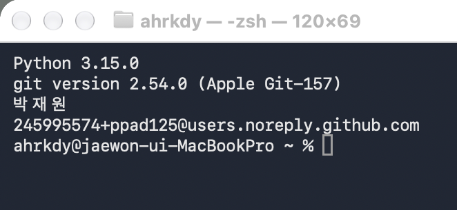
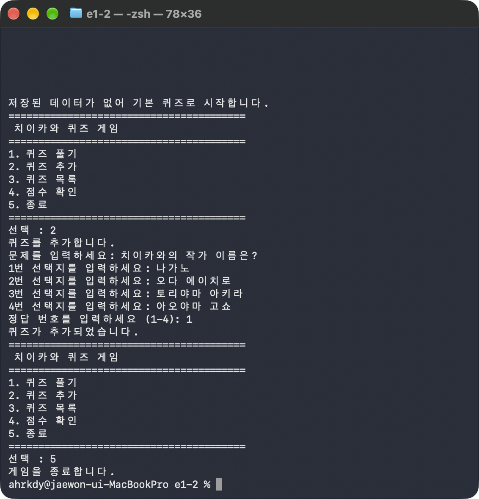
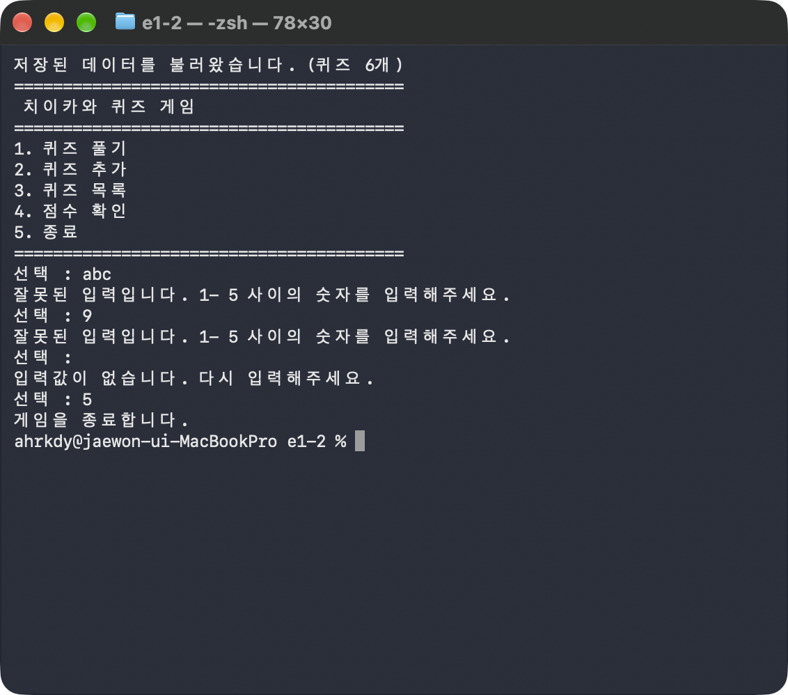
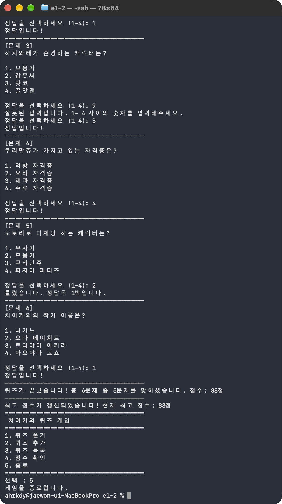
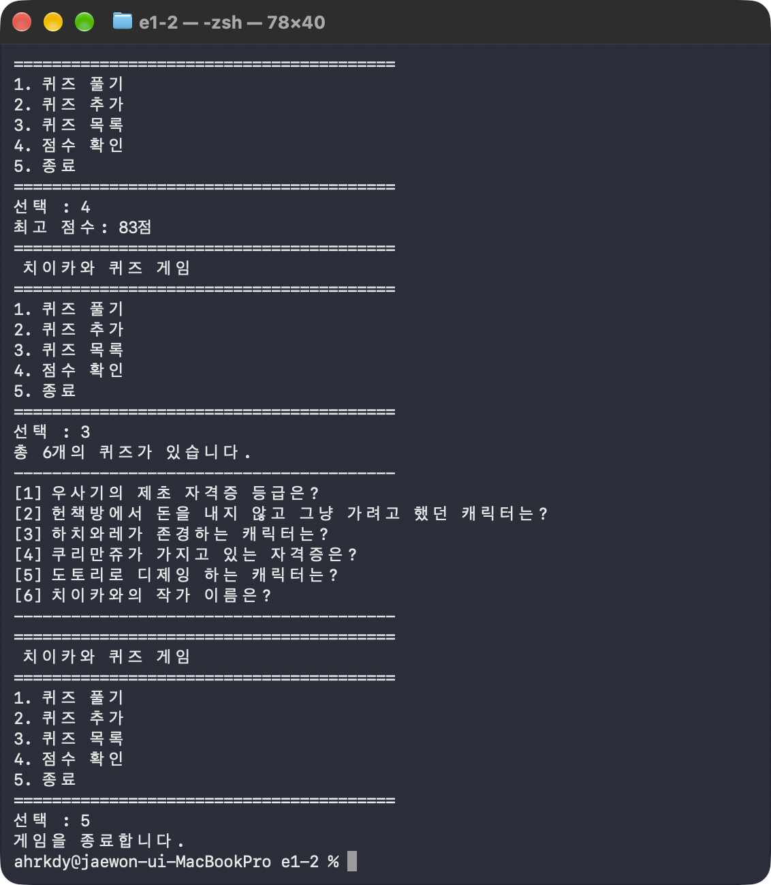
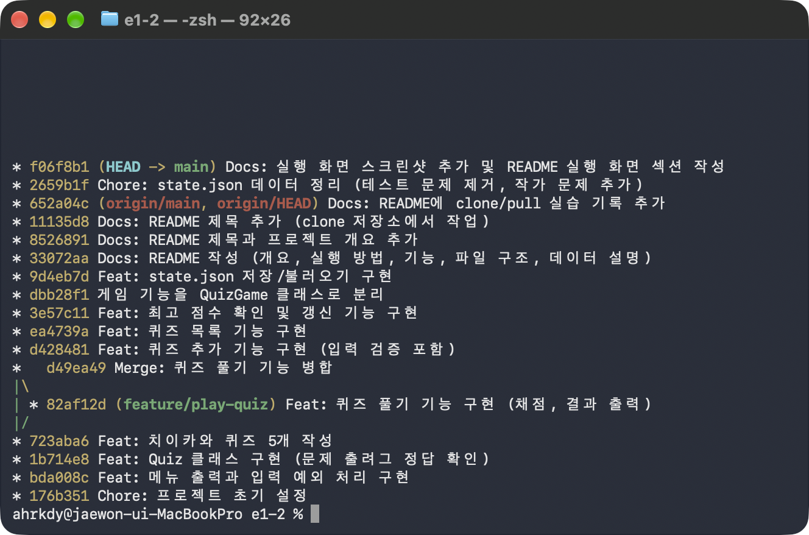

# E1-2. 컴퓨터에게 명령 내리는 말(파이썬) 처음 배우기

> 🐹 **치이카와 퀴즈 게임** — 터미널에서 동작하는 Python 퀴즈 게임

## 1. 프로젝트 개요
터미널 메뉴에서 번호를 골라 퀴즈를 풀고, 새 퀴즈를 추가하고, 목록과 최고 점수를 확인하는 콘솔 프로그램입니다.
`Quiz`(퀴즈 1개)와 `QuizGame`(게임 전체) 두 클래스로 역할을 나눴고, 퀴즈와 최고 점수는 `state.json`에 저장해 프로그램을 껐다 켜도 유지됩니다.
기능을 하나 완성할 때마다 커밋하고, 퀴즈 풀기 기능은 브랜치에서 작업한 뒤 병합했습니다.

**퀴즈 주제와 선정 이유**
- 주제: 치이카와 (만화/캐릭터)
- 선정 이유: 최근 영화 개봉으로 인기가 많고, 캐릭터가 귀여워서 선정했습니다.

## 2. 실행 환경

| 항목 | 내용 |
|---|---|
| OS | macOS 27.2.1 |
| Shell | zsh 5.9 |
| Python | 3.15.0 (Homebrew, `/opt/homebrew/bin/python3`) — 미션 조건 3.10 이상 |
| Git | 2.54.0 (Apple Git-157) |
| 에디터 | VSCode + Python 확장 |
| 외부 라이브러리 | 없음 (표준 라이브러리 `json`, `pathlib`, `shutil`만 사용) |



## 3. 실행 방법

```bash
git clone https://github.com/ppad125/codyssey-e1-2.git
cd codyssey-e1-2
python3 main.py
```

→ 첫 줄에 `저장된 데이터를 불러왔습니다. (퀴즈 6개)`가 나오고 메뉴가 표시되면 성공입니다.
`state.json`이 없으면 `저장된 데이터가 없어 기본 퀴즈로 시작합니다.`가 나오고 기본 퀴즈 5개로 시작합니다.

## 4. 수행 체크리스트
**퀴즈 게임**
- [x] 메뉴 출력과 번호 선택 (풀기 / 추가 / 목록 / 점수 / 종료)
- [x] 퀴즈 풀기: 출제 → 정답 입력 → 정답/오답 안내 → 결과(점수) 표시, 퀴즈가 없을 때 처리
- [x] 퀴즈 추가: 문제, 선택지 4개, 정답 번호 입력 후 파일 저장
- [x] 퀴즈 목록: 등록된 퀴즈 출력, 퀴즈가 없을 때 처리
- [x] 점수 확인: 최고 점수 출력·갱신·저장, 아직 풀지 않았을 때 처리
- [x] 직접 작성한 치이카와 퀴즈 5개 이상 (현재 6개)

**입력·예외 처리**
- [x] 앞뒤 공백 제거, 문자 입력(`abc`), 범위 밖 숫자(`0`, `9`), 빈 입력 → 안내 후 재입력
- [x] `Ctrl+C`(KeyboardInterrupt), 입력 종료(EOFError) → 저장 후 안전 종료
- [x] `state.json`이 없을 때 기본 퀴즈 사용, 손상됐을 때 안내 후 복구
- [x] 저장할 때마다 직전 파일 자동 백업(`state.json.bak`), 손상 파일 보관(`state.corrupted.json`)

**코드 구조**
- [x] 클래스 2개 이상 (`Quiz`, `QuizGame`), 기능별 메서드 분리
- [x] 프로젝트 루트의 `state.json`에 UTF-8로 저장·불러오기

**Git**
- [x] 의미 있는 커밋 10개 이상 (기능 단위, `Feat`/`Refactor`/`Docs`/`Chore`)
- [x] 브랜치 생성과 병합 (`feature/play-quiz` → `main`, 병합 커밋 `d49ea49`)
- [x] clone, pull 실습 (`e1-2-clone` 폴더에서 push → 원래 폴더에서 pull)
- [x] 기초 명령어 7종 (init, add, commit, push, pull, checkout, clone) 모두 사용
- [x] README 필수 항목 (개요, 주제 선정 이유, 실행 방법, 기능 목록, 파일 구조, 데이터 파일 설명)

## 5. 기능 목록

| 메뉴 | 기능 | 실행 로그 |
|---|---|---|
| 1. 퀴즈 풀기 | 저장된 퀴즈를 순서대로 출제하고, 정답/오답과 점수(100점 만점)를 보여 줍니다. 최고 점수를 넘으면 갱신합니다. | [02-play](logs/02-play.md) |
| 2. 퀴즈 추가 | 문제, 선택지 4개, 정답 번호를 입력받아 등록하고 바로 저장합니다. | [03-add-quiz](logs/03-add-quiz.md) |
| 3. 퀴즈 목록 | 등록된 퀴즈의 문제를 번호와 함께 보여 줍니다. | [03-add-quiz](logs/03-add-quiz.md) |
| 4. 점수 확인 | 최고 점수를 보여 주고, 아직 풀지 않았다면 안내합니다. | [04-persistence](logs/04-persistence.md) |
| 5. 종료 | 데이터를 저장하고 종료합니다. | [01-menu-input](logs/01-menu-input.md) |

입력 예외 처리는 [01-menu-input](logs/01-menu-input.md), 안전 종료는 [06-interrupt](logs/06-interrupt.md), 파일 오류와 백업 복구는 [05-file-errors](logs/05-file-errors.md)에 실제 출력을 기록했습니다.

## 6. 파일 구조

```text
codyssey-e1-2/
├── main.py              # 게임 코드 (Quiz, QuizGame 클래스, 입력 함수)
├── state.json           # 퀴즈와 최고 점수 저장 파일
├── README.md            # 기술 문서
├── .gitignore           # 캐시, 에디터 설정, 백업 파일 제외
├── logs/                # 기능별 실제 실행 출력과 Git 기록
│   └── 01-menu-input.md ~ 07-git.md
└── docs/
    └── screenshots/     # 실행 화면 캡처
```

`state.json.bak`, `state.corrupted.json`은 실행 중 자동으로 생기는 로컬 파일이라 `.gitignore`로 제외했습니다.

**코드 구성**

| 클래스 / 함수 | 메서드 | 책임 |
|---|---|---|
| `Quiz` | `display` | 문제와 선택지 출력 |
| | `is_correct` | 입력한 번호가 정답인지 판정 |
| | `to_dict` | JSON 저장을 위해 dict로 변환 |
| `QuizGame` | `show_menu`, `run` | 메뉴 출력, 선택한 기능 실행 |
| | `play_quiz`, `update_best_score` | 퀴즈 진행과 채점, 최고 점수 갱신 |
| | `add_quiz`, `list_quizzes`, `show_score` | 퀴즈 추가, 목록, 점수 확인 |
| | `load_state`, `save_state`, `keep_corrupted_file` | 불러오기, 저장(백업 포함), 손상 파일 보관 |
| 일반 함수 | `read_number`, `read_text` | 사용자 입력 검증 |
| | `create_default_quizzes` | 기본 퀴즈 5개 생성 |

**입력 검증과 데이터 입출력을 나눈 기준:** `read_number`, `read_text`는 키보드 입력을 받아 올바른 값이 나올 때까지 다시 묻는 일만 합니다. 파일을 읽고 쓰는 일은 `load_state`, `save_state`만 합니다. 예를 들어 `add_quiz`는 입력 함수로 값을 받고, 저장은 `save_state`에 맡깁니다. 입력 함수는 게임 데이터가 필요 없어서 클래스 밖에 두었습니다.

## 7. 데이터 파일 설명 (state.json)
- **경로:** 프로젝트 루트의 `state.json`. 코드에서는 `Path(__file__).parent / "state.json"`으로, 어느 폴더에서 실행해도 `main.py`와 같은 폴더에 저장됩니다.
- **역할:** 퀴즈 목록과 최고 점수를 저장해 다시 실행해도 유지되게 합니다.
- **인코딩:** UTF-8 (`ensure_ascii=False`로 한글을 그대로 저장)

```json
{
    "quizzes": [
        {
            "question": "우사기의 제초 자격증 등급은?",
            "choices": ["1급", "2급", "3급", "5급"],
            "answer": 2
        }
    ],
    "best_score": 83
}
```

| 키 | 타입 | 설명 | 이렇게 정한 이유 |
|---|---|---|---|
| `quizzes` | list | 퀴즈 목록 | 순서대로 출제하고 번호로 보여 주므로 순서가 있는 list |
| `question` | str | 문제 | 퀴즈 하나의 정보를 이름이 붙은 dict로 묶어(중첩 구조) 파일만 봐도 의미를 알 수 있고, `Quiz` 속성 이름과 같아 변환이 쉬움 |
| `choices` | list | 선택지 4개 | 1~4번이라는 순서가 있음 |
| `answer` | int | 정답 번호 (1~4) | 사용자가 입력한 번호와 바로 비교할 수 있음 |
| `best_score` | int 또는 null | 최고 점수 | 게임 전체에 하나뿐인 값이라 `quizzes`와 같은 높이에 둠. 아직 풀지 않았으면 `null`로 0점과 구분 |

**저장 시점:** 퀴즈 추가 직후, 최고 점수 갱신 직후, 메뉴 5번 종료 시, `Ctrl+C`/EOF로 중단될 때

**불러오기 순서 (`load_state`)**
1. `state.json`을 UTF-8로 열어 JSON을 읽습니다.
2. `quizzes`의 각 항목을 `Quiz` 객체로 바꾸고 `best_score`를 읽습니다.
3. 파일이 없으면(`FileNotFoundError`) → 기본 퀴즈 5개로 시작합니다.
4. JSON이 깨졌거나 항목이 없으면(`ValueError`, `KeyError`, `TypeError`) → 손상 파일을 `state.corrupted.json`으로 옮겨 보관하고 기본 퀴즈로 복구합니다.

**백업과 복구**

| 상황 | 프로그램 동작 | 사용자가 할 수 있는 조치 |
|---|---|---|
| 파일 없음 (첫 실행) | 기본 퀴즈로 시작 | 없음 |
| 파일 손상 | 손상 파일 보관 후 기본 퀴즈로 복구 | `cp state.json.bak state.json`으로 직전 데이터 복구 |
| 저장 실패 (`OSError`) | 안내 문구 출력, 게임은 계속 | 폴더 권한과 디스크 공간 확인 |
| 처음 상태로 초기화 | - | `rm state.json` 후 실행하면 기본 퀴즈로 시작 |

📄 실제 동작: [logs/05-file-errors.md](logs/05-file-errors.md)

## 8. 실행 화면

| 퀴즈 추가 (파일이 없는 첫 실행) | 재실행 시 데이터 유지 + 입력 예외 처리 |
|---|---|
|  |  |

| 퀴즈 풀기 (결과와 최고 점수 갱신) | 점수 확인과 목록 |
|---|---|
|  |  |

## 9. Git 작업 기록

### 9-1. 커밋 규칙
- **기능 하나를 완성할 때마다** 커밋했습니다: 초기 설정 → 메뉴 → Quiz 클래스 → 기본 데이터 → 풀기(브랜치) → 추가 → 목록 → 점수 → 구조 정리 → 저장 → 문서
- 메시지 형식은 `종류: 무엇을 했는지`입니다.

| 종류 | 의미 | 이 저장소의 예 |
|---|---|---|
| `Feat` | 새 기능 | `Feat: 퀴즈 목록 기능 구현` |
| `Refactor` | 동작은 같고 구조만 개선 | 게임 기능을 QuizGame 클래스로 분리 (`dbb28f1`, 접두어를 빠뜨림) |
| `Docs` | 문서 | `Docs: README 작성 (...)` |
| `Chore` | 설정, 데이터 정리 | `Chore: 프로젝트 초기 설정` |

### 9-2. 브랜치를 나눈 이유와 병합
- **이유:** 퀴즈 풀기는 게임의 핵심이라 수정 범위가 컸습니다. `main`에서 바로 작업하다 실수하면 이미 동작하던 메뉴까지 망가질 수 있어, `feature/play-quiz` 브랜치에서 따로 작업했습니다. 팀 작업에서도 기능별 브랜치를 쓰면 서로의 작업이 섞이지 않습니다.
- **절차:** `git checkout -b feature/play-quiz` → 구현·실행 확인 → 커밋 `82af12d` → `git checkout main` → `git merge --no-ff feature/play-quiz` → 병합 커밋 `d49ea49`
- **`--no-ff`를 쓴 이유:** `main`에 새 커밋이 없으면 Git은 병합 기록 없이 `main`만 앞으로 옮깁니다(fast-forward). 병합 커밋을 남겨 브랜치 작업 기록이 그래프에 보이게 했습니다.
- **병합 전 확인:** 커밋하지 않은 변경이 없는지 `git status`로 확인합니다. (처음에 커밋 없이 병합해 `Already up to date`가 나왔던 경험 → [10-5](#10-5-커밋-없이-병합해-already-up-to-date-git))

```text
*   d49ea49 Merge: 퀴즈 풀기 기능 병합
|\
| * 82af12d Feat: 퀴즈 풀기 기능 구현 (채점, 결과 출력)
|/
* 723aba6 Feat: 치이카와 퀴즈 5개 작성
```

### 9-3. clone과 pull 실습
1. `git clone git@github.com:ppad125/codyssey-e1-2.git e1-2-clone`으로 별도 폴더에 복제
2. 복제한 폴더에서 README에 섹션 추가 → commit → push (`652a04c`)
3. 원래 폴더 `e1-2`에서 `git pull` → `Fast-forward`로 반영 확인



📄 커밋 그래프 텍스트, 브랜치·병합과 clone·pull의 `reflog` 기록, 명령어 7종 사용처: [logs/07-git.md](logs/07-git.md)

## 10. 트러블슈팅
실제로 작업하면서 겪은 문제입니다.

### 10-1. `python3`가 3.9.6으로 실행됨 (환경)
- **문제:** 미션은 Python 3.10 이상인데 `python3 --version`이 3.9.6이었습니다.
- **원인:** Homebrew에 3.15가 설치돼 있었지만 `~/.zprofile`에 Homebrew 경로 설정이 없어, macOS 기본 `/usr/bin/python3`가 먼저 실행됐습니다.
- **해결:** `echo 'eval "$(/opt/homebrew/bin/brew shellenv)"' >> ~/.zprofile` → `source ~/.zprofile` → `which python3`가 `/opt/homebrew/bin/python3`로 바뀜
- **배운 점:** 같은 명령도 PATH 순서에 따라 다른 프로그램이 실행됩니다. 버전은 `which`로 위치까지 확인합니다.

### 10-2. VSCode 터미널 위치가 `/`라서 git이 동작하지 않음 (환경)
- **문제:** VSCode의 실행 버튼으로 실행하니 터미널 프롬프트가 `/ %`였습니다. 프로젝트 폴더 밖이라 그 위치에서는 git 명령을 쓸 수 없는 상태였습니다.
- **원인:** 폴더가 아니라 `main.py` 파일 하나만 열어서, 터미널이 프로젝트 밖에서 시작됐습니다.
- **해결:** `cd ~/Codyssey/e1-2`로 이동했습니다. 저장 파일도 실행 위치에 따라 엉뚱한 곳에 생기지 않도록 `Path(__file__).parent`를 기준으로 경로를 정했습니다.

### 10-3. `NameError: name 'self' is not defined` (Python)
- **문제:** `display` 메서드 실행 중 오류가 났습니다.
- **원인:** `def display(salf, number)`로 첫 매개변수 이름을 잘못 썼는데, 본문에서는 `self`를 사용했습니다.
- **해결:** `self`로 고쳤습니다. 오류 메시지의 `Did you mean: 'salf'?`가 힌트였습니다.
- **배운 점:** `self`는 예약어가 아니라 첫 번째 매개변수의 이름일 뿐이라, 이름이 다르면 다른 변수가 됩니다.

### 10-4. `{len(quizzes)}`가 글자 그대로 출력됨 / 입력이 끝나지 않음 (Python)
- **문제 1:** `퀴즈를 시작합니다! (총 {len(quizzes)}문제)`처럼 중괄호가 그대로 보였습니다. → 문자열 앞에 `f`가 빠져 있었습니다.
- **문제 2:** 퀴즈 추가에서 문제를 입력해도 같은 질문이 계속 반복됐습니다. → `read_text`에 `return text`가 빠져 `while True`가 끝나지 않았습니다.
- **배운 점:** f-string은 `f` 접두어가 있어야 값이 들어가고, 무한 반복문은 `return`이나 `break`로 끝내는 길이 반드시 있어야 합니다.

### 10-5. 커밋 없이 병합해 `Already up to date` (Git)
- **문제:** `git merge --no-ff feature/play-quiz`가 `Already up to date.`로 끝나고 병합 기록이 생기지 않았습니다.
- **원인:** 브랜치에서 `git add`/`git commit`을 하지 않고 `main`으로 넘어갔습니다. 커밋하지 않은 수정은 어느 브랜치에도 속하지 않아 `M main.py` 상태로 따라다닙니다.
- **해결:** `git checkout feature/play-quiz` → 커밋 → `git checkout main` → 병합에 성공했습니다(`d49ea49`).

### 10-6. clone 실습 커밋을 원래 폴더에서 함 (Git)
- **문제:** clone한 폴더에서 해야 할 commit/push를 원래 폴더에서 해서, 마지막 `git pull`이 `Already up to date.`였습니다.
- **원인:** clone 폴더로 이동하지 않은 채, 원래 폴더(`e1-2 %`)에서 명령을 입력했습니다.
- **해결:** `e1-2-clone`으로 이동해 다시 commit/push하고, 원래 폴더에서 `git pull`로 `Fast-forward`를 확인했습니다. 잘못 만든 `11135d8`은 기록을 덮어쓰지 않도록 그대로 두었습니다.
- **배운 점:** 명령 전에 프롬프트의 폴더 이름을 확인합니다.

### 10-7. zsh에서 `#`이 `command not found` (터미널)
- **문제:** 터미널에 `# README 뼈대 만들기`를 입력하니 `command not found: #`이 나왔습니다.
- **원인:** zsh는 기본 설정에서 직접 입력한 줄의 `#`을 주석으로 처리하지 않습니다.
- **해결:** `echo 'setopt interactivecomments' >> ~/.zshrc`로 설정했습니다.

## 11. 개념 정리 (과제 목표)

### 11-1. 변수와 자료형
- **변수**는 값에 이름을 붙여 저장해 두고 다시 쓰는 것입니다. 예: `correct_count = 0`으로 맞힌 개수를 세면서 갱신합니다.

| 자료형 | 이 프로젝트의 예 | 특징 |
|---|---|---|
| `int` | `answer = 2`, `score` | 정수, 계산과 비교 |
| `str` | `question`, `input()`의 결과 | 문자열, `input()`은 항상 str을 돌려줘서 `int()`로 변환 |
| `bool` | `is_correct()`의 결과 | `True`/`False` |
| `list` | `self.quizzes`, `choices` | 순서가 있는 여러 값, `append`로 추가 |
| `dict` | `to_dict()`의 결과, JSON 데이터 | 이름(키)으로 값을 찾음 |

### 11-2. 조건문과 반복문
- **`if/elif/else`:** 메뉴 번호에 따라 하나의 기능만 실행합니다 (`run`).
- **`for`:** 반복 횟수가 정해져 있을 때 씁니다. 퀴즈 목록을 하나씩 출제하거나, 선택지 4개를 입력받을 때 사용했습니다.
- **`while`:** 언제 끝날지 모를 때 씁니다. 올바른 입력이 나올 때까지 묻기(`read_number`), 종료를 고를 때까지 메뉴 반복(`run`)에 사용했습니다.

### 11-3. 함수 (매개변수와 반환값)
`read_number(prompt, min_value, max_value)`는 매개변수로 안내 문구와 범위를 받아, 메뉴(1~5)와 정답(1~4) 입력에 **같은 함수를 재사용**합니다. 검증을 통과한 값은 `return`으로 돌려줍니다.

### 11-4. 클래스와 객체
- **클래스**는 데이터(속성)와 동작(메서드)을 묶은 설계도이고, **객체**는 그 설계도로 만든 실체입니다. `Quiz(...)`를 호출할 때마다 문제가 다른 객체가 만들어집니다.
- **`__init__`**은 객체를 만들 때 자동으로 실행되어 초기값을 넣습니다.
- **`self`**는 지금 다루는 그 객체 자신입니다. 퀴즈가 여러 개여도 각자의 `self.question`을 구분합니다.
- **클래스를 쓴 이유:** 처음엔 함수만으로 만들었는데, `quizzes`와 `best_score`를 모든 함수에 넘기고 돌려받아야 해서 복잡했습니다. `QuizGame`으로 묶어 데이터를 `self.quizzes`, `self.best_score`로 두니 넘길 필요가 없어졌습니다 (`dbb28f1`).

| 비교 | 함수만 사용 | 클래스 사용 |
|---|---|---|
| 데이터 전달 | 함수마다 매개변수로 넘기고 반환값으로 받음 | 객체가 데이터를 가지고 `self`로 접근 |
| 역할 구분 | 함수가 한 파일에 나열됨 | 퀴즈 1개(`Quiz`)와 게임 전체(`QuizGame`)로 책임이 나뉨 |
| 기능 추가 | 새 데이터가 생기면 여러 함수의 매개변수를 고쳐야 함 | 속성과 메서드만 추가 |
| 단점 | 작은 프로그램에는 충분히 단순함 | 클래스와 `self` 개념을 알아야 함 |

### 11-5. 파일 입출력, JSON, 예외 처리
- **파일 입출력:** `with open(경로, "r"/"w", encoding="utf-8")`로 열고, 블록이 끝나면 자동으로 닫힙니다. `"w"`는 기존 내용을 덮어씁니다.
- **JSON을 쓴 이유:** 텍스트라 사람이 열어서 읽고 고칠 수 있고, Python의 dict/list와 모양이 같아 `json.load`/`json.dump`만으로 저장할 수 있습니다. CSV는 선택지 같은 중첩 데이터를 담기 어렵고, `pickle`은 사람이 읽을 수 없습니다.
- **JSON 방식의 한계:**
  - 저장할 때마다 **파일 전체를 다시 씁니다.** 퀴즈가 수만 개로 늘면 저장이 느려집니다.
  - 불러올 때 **전체 데이터를 메모리에 올립니다.** 데이터가 크면 메모리 부담이 커집니다.
  - 여러 프로그램이 동시에 쓰면 내용이 섞일 수 있습니다. 규모가 커지면 SQLite 같은 데이터베이스가 적합합니다.
- **try/except:** 오류가 나도 프로그램이 멈추지 않게 처리합니다. `int("abc")`의 `ValueError`, 파일 없음 `FileNotFoundError`, 깨진 JSON의 `ValueError`, 저장 실패 `OSError`, `Ctrl+C`의 `KeyboardInterrupt`를 각각 처리했습니다.

### 11-6. Git 기초
- **Git**은 내 컴퓨터에서 변경 이력을 기록하는 도구이고, **GitHub**는 그 기록을 올려 공유하는 원격 저장소입니다.

| 명령 | 하는 일 |
|---|---|
| `init` | 폴더를 Git 저장소로 만듦 |
| `add` | 커밋할 변경을 스테이징(장바구니에 담기) |
| `commit` | 스테이징한 변경을 기록으로 남김 |
| `push` | 로컬 커밋을 원격(GitHub)에 올림 |
| `pull` | 원격의 새 커밋을 가져와 합침 |
| `checkout` | 브랜치 이동 (`-b`로 생성과 동시에 이동) |
| `clone` | 원격 저장소를 통째로 복제 |

## 12. 변경 가이드
요구사항이 바뀌면 아래를 수정합니다. 코드는 모두 `main.py`에 있습니다.

| 바꾸고 싶은 것 | 수정할 곳 |
|---|---|
| 기본 퀴즈 내용 | `create_default_quizzes()` (반영하려면 `state.json` 삭제 후 실행) |
| 메뉴 항목 추가 | `QuizGame.show_menu()`, `QuizGame.run()`, `read_number`의 범위(1~5) |
| 선택지 개수 (4개 → 5개 등) | `add_quiz()`의 `range(4)`, 정답 입력 범위 `read_number(..., 1, 4)` (`play_quiz`, `add_quiz`) |
| 점수 계산 방식 | `QuizGame.play_quiz()`의 `score` 계산, `update_best_score()` |
| 저장 항목 추가 (예: 힌트) | `Quiz.__init__`, `Quiz.to_dict`, `QuizGame.load_state`, `QuizGame.save_state`, 이 문서의 7장 |
| 저장 파일 이름·위치 | 파일 위쪽의 `STATE_FILE`, `BACKUP_FILE`, `CORRUPTED_FILE` |

## 13. 재현 방법
각 코드블록을 복사해 터미널에 붙여 넣어 실행할 수 있습니다. (macOS, zsh 기준)

**1. 저장소 받기와 실행**

```bash
git clone https://github.com/ppad125/codyssey-e1-2.git
cd codyssey-e1-2
python3 --version
python3 main.py
```

→ Python 3.10 이상인지 확인하고, 메뉴에서 1~5를 눌러 봅니다. `5`로 종료합니다.

**2. 파일이 없을 때**

```bash
mv state.json state.json.keep
python3 main.py
```

→ `저장된 데이터가 없어 기본 퀴즈로 시작합니다.`가 나옵니다. `5`로 종료하면 `state.json`이 새로 생깁니다.

**3. 파일이 손상됐을 때와 백업 복구**

```bash
echo "{ broken" > state.json
python3 main.py
```

→ `데이터 파일이 손상되어 기본 퀴즈로 복구합니다.`가 나옵니다. `5`로 종료한 뒤 아래로 원래 데이터를 되돌립니다.

```bash
mv state.json.keep state.json
python3 main.py
```

→ `저장된 데이터를 불러왔습니다. (퀴즈 6개)`가 나오면 복구된 것입니다.
